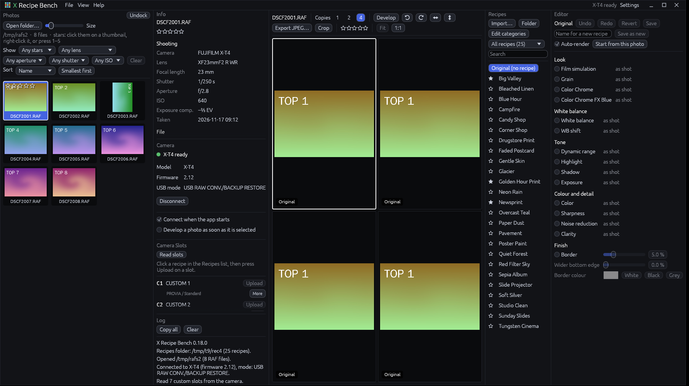

# X Recipe Bench

Develop Fujifilm RAF files through the camera's own image processor, over USB,
and build, organise and apply film recipes. The camera does the conversion, so
the result matches its in-camera JPEGs.



An independent, unofficial project. It is not affiliated with or endorsed by
FUJIFILM Corporation.

## Status

Early, and tested narrowly. Read this before relying on it.

- **Tested on:** one Fujifilm X-T4 (firmware 2.12), on Linux with X11.
  Developing, exporting, and reading and writing the camera's custom slots
  (C1–C7) have been confirmed on that camera.
- **Other camera bodies:** untested. Slider ranges and film simulations are
  the X-T4's.
- **Windows and macOS:** never built. The code is written to be portable, but
  nobody has compiled or run it there.
- **Wayland:** untested. Remembering window positions and snapping windows
  together need X11 in any case.

Software that talks to a camera over USB is used at your own risk.

## Download

Get the AppImage from the [Releases](../../releases) page, make it executable
and run it:

```
chmod +x X-Recipe-Bench-*.AppImage
./X-Recipe-Bench-*.AppImage
```

It needs glibc 2.35 or newer (Ubuntu 22.04 and later, and similar).

## Connecting the camera

1. On the camera, set the USB mode to **USB RAW CONV./BACKUP RESTORE**.
2. Connect it by USB and switch it on.
3. Start the app. It connects by itself, or press **Connect** in the Camera
   panel.

If the app says the camera is busy, another program has taken it. On many
Linux desktops that is the file manager's camera service; the **Free the
camera** button stops it for this session.

If it says "permission denied", install the rule in `packaging/linux/`:

```
sudo cp packaging/linux/70-x-recipe-bench.rules /etc/udev/rules.d/
sudo udevadm control --reload
```

A RAF can only be developed by the camera model that shot it.

## The screen

One fixed screen, left to right:

| Panel | What it is for |
|---|---|
| **Photos** | Thumbnails of the open folder, with stars, filters and sorting. The only panel that can be undocked into its own window. |
| **Info, Camera, Camera Slots, Log** | A strip: the selected photo's details, the camera connection, the camera's custom slots, and a record of what happened. |
| **Preview** | The selected photo as the camera develops it: 1, 2 or 4 copies side by side, each with its own recipe. |
| **Recipes** | The recipe list. The card for the recipe under the mouse opens to its left. |
| **Editor** | Every setting of the current recipe, plus the border. |

The app always opens maximised in this arrangement.

## What it does

**Developing**
- Sends a RAF to the camera and shows the JPEG the camera makes from it.
- 1, 2 or 4 copies of the same photo with different recipes, each labelled.
- Zoom and pan; rotate and flip; crop (free, fixed or custom shapes) and
  straighten.
- Export the full-size JPEG, with optional border, resize and file-name
  pattern. A photo that is not turned, cropped, bordered or resized is saved
  exactly as the camera made it.
- Batch export: one photo or every photo shown, with one look or every look
  in the Preview.

**Recipes**
- Each recipe is its own `.FP1` file (the X RAW Studio format) in a `Recipes`
  folder beside the app. Files are never merged into a database.
- Categories live in `categories.txt` in that folder. A recipe can be in
  several; deleting a category never deletes a file.
- Descriptions are stored inside the FP1 file.
- Import files or whole folders; make a recipe from pasted text, or from the
  look stored in a Fujifilm JPEG or RAF.
- 25 starter recipes are installed the first time.
- Optional sample pictures: the camera develops a photo of yours with each
  recipe, once, and the small result is kept in `Recipes/Samples/`.

**Camera custom slots**
- Reads the camera's slots (C1, C2, …) and their names.
- Uploads a recipe and a name into a slot. What the slot held is first saved
  as a recipe file in a "Camera backups" category, and every setting is read
  back afterwards.
- Saves a slot's contents into the library, and restores a backup.

**Photos**
- Stars (1–5), crop and rotation are written to one file per photo folder,
  `X Recipe Bench.json`. The RAF files are never changed.
- Filter by stars, lens, aperture, shutter speed and ISO; sort by any of
  those, name or date.
- Shows each photo's shutter count and the range across the folder.

**Appearance**
- Dark and light modes and five appearances, in Settings.

## Building from source

Needs Rust (stable). On Debian or Ubuntu, also:

```
sudo apt install libudev-dev libxkbcommon-dev libwayland-dev libx11-dev libxcb1-dev libgl1-mesa-dev
```

```
cargo test --workspace             # includes tests against a simulated camera
cargo run -p x-recipe-bench        # runs the app
packaging/appimage/build.sh        # makes dist/X-Recipe-Bench-<version>-x86_64.AppImage
                                   # (needs appimagetool on PATH or in $APPIMAGETOOL)
```

To try the camera screens without a camera, start the app with the
environment variable `XRP_SIMULATED_CAMERA=1`. The simulated camera cannot
develop real pictures. A stand-in RAF for testing can be made from any JPEG:

```
cargo run -p xrp-camera --example make_sample_raf -- in.jpg out.RAF
```

## Layout of the code

```
crates/camera/         talks to the camera; no user interface
  src/transport.rs     USB in and out (and the trait the tests fake)
  src/ptp.rs           Picture Transfer Protocol: framing, codes, datasets
  src/camera.rs        connect, upload a RAF, develop it
  src/profile.rs       the settings block the camera develops with
  src/slots.rs         the camera's custom slots: read and write
  src/exif.rs          reads the details a camera writes into a photo
  src/raf.rs           reads the header and embedded preview of a RAF file
  src/busy.rs          finds which other program is holding the camera
  src/sim.rs           a simulated camera, for tests and for trying the app
  tests/               the real protocol code run against the simulated camera
crates/recipes/        recipes; no camera access, no user interface
  src/fp1.rs           reads and writes .FP1 recipe files
  src/settings.rs      what a recipe says, and the words FP1 uses for it
  src/apply.rs         recipe -> camera settings block, and back
  src/slot.rs          recipe -> custom-slot values and write order, and back
  src/library.rs       the recipes folder and categories.txt
  src/from_photo.rs    the look a photo was shot with, read from the photo
  src/starters.rs      the recipes a new library starts with
  src/text_import.rs   reads a recipe written out as plain text
crates/app/            the window
  src/app.rs           title bar, the fixed screen, the Photos window, settings
  src/dock.rs          the list of panels
  src/panels/          one file per panel (plus the crop editor and colour pad)
  src/state.rs         the data all panels share
  src/camera_worker.rs background thread that owns the camera
  src/image_worker.rs  background thread that decodes pictures
  src/photo.rs         stars, crop, the per-folder notes file, filter and sort
  src/export.rs        how exported JPEGs are finished and named
  src/border.rs        the border around a photo
  src/orientation.rs   how a photo is turned (quarter turns and flips)
  src/samples.rs       recipe sample pictures
  src/slots.rs         what the app knows about the camera's custom slots
  src/theme.rs         dark and light modes and the five appearances
  src/chrome.rs        the app-drawn title bar, window buttons and edges
  src/windows.rs       window positions, snapping, and the maximise area
  src/pointer.rs       asks the system about the mouse and the monitors
  src/settings.rs      what is remembered between runs
  src/paths.rs         where the recipes folder is
packaging/             AppImage build script, desktop entry, udev rule
```

Every source file starts with a plain-language note on what it is for.

## Credits

- Camera protocol knowledge:
  [fujifilm-ptp-reference](https://github.com/zgrimz/fujifilm-ptp-reference)
  by zgrimz, licensed CC BY 4.0.
- `.FP1` vocabulary, and a captured profile used by one optional test: the
  libfuji project (MIT).
- Fujifilm property and operation names: the libgphoto2 project's public
  header.
- Inspired by [grawji](https://github.com/p5k369/grawji). No code from grawji
  or rawji is used.

FUJIFILM, X-T4 and X RAW STUDIO are trademarks of FUJIFILM Corporation, used
here only to say what this software works with.

## Licence

MIT. See [LICENSE](LICENSE).
